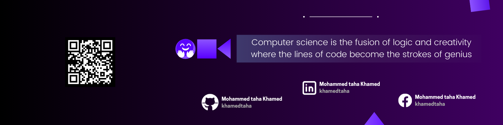

# Hi there, I'm Mohammed Taha 👋

  

---

## 🚀 About Me

I'm a **Computer Science graduate** with a passion for building robust backend systems and exploring the frontiers of AI/ML. Currently specializing in Python development, I have professional experience designing RESTful APIs with **Django**, **FastAPI**, and **Django REST Framework**. My work focuses on creating scalable solutions with clean architecture, while continuously expanding my expertise in data engineering and machine learning.

**Key Strengths :**  

✔️ Backend Development & API 

✔️ Python Development & Scripting  

✔️ Collaborative Problem Solving  

---
## 🛠️ Tech Stack

<table align="left">
  <tr>
    <td align="center" width="120"><b>Languages</b></td>
    <td align="left">
      
    </td>
  </tr>
  <tr>
    <td align="center" width="120"><b>Frontend</b></td>
    <td align="left">
      
    </td>
  </tr>
  <tr>
    <td align="center" width="120"><b>Backend</b></td>
    <td align="left">
      
    </td>
  </tr>
  <tr>
    <td align="center" width="120"><b>Databases</b></td>
    <td align="left">
      
    </td>
  </tr>
  <tr>
    <td align="center" width="120"><b>AI / LLMs</b></td>
    <td align="left">
      
      
      
     </td>  
  </tr>
  <tr>
    <td align="center" width="120"><b>DevOps</b></td>
    <td align="left">
      
    </td>
  </tr>
</table>

 

---

## 📈 GitHub Analytics

  

  

---

## 🌟 Professional Philosophy

> *"Clean code isn't written - it's sculpted through relentless refinement. I strive to build systems that are as maintainable as they are powerful, always balancing cutting-edge solutions with real-world practicality."*

---

## 📬 Let's Connect !

I'm always open to discussing:
- Backend architecture challenges
- Machine learning implementations
- Open-source collaborations
- Career opportunities

---

## 📫 Contact Me

- Email: [khamedkh297@gmail.com](mailto:khamedkh297@gmail.com)
- LinkedIn : [Mohammed Taha](https://www.linkedin.com/in/khamedtaha/)
- Twitter  : [Mohammed taha](https://x.com/khamedtaha)
